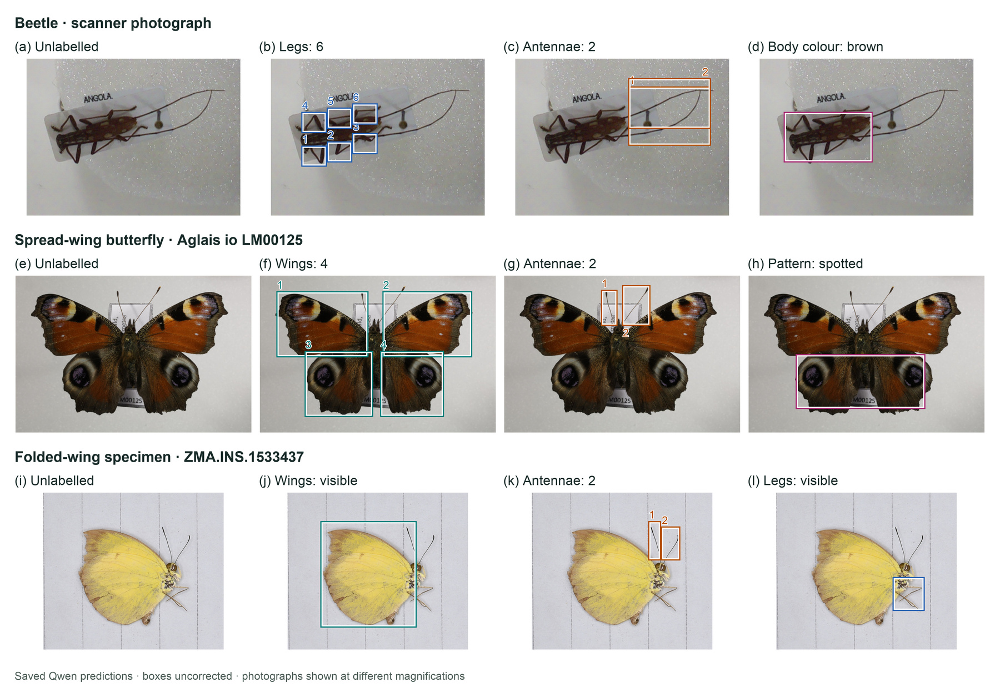
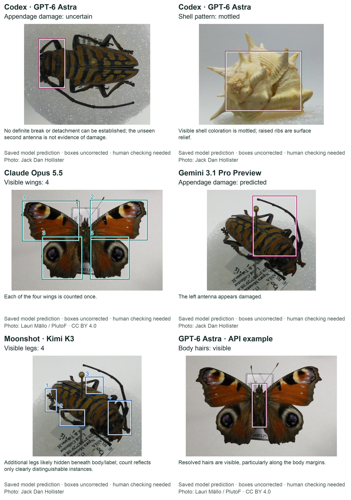

# Local AI for specimen features

I wanted to see whether a local **vision-language model (VLM)** could pick out features in specimen photographs using what it already knew. I ran **Qwen on Dell GB10 hardware**, with a prompt and no fine-tuning.

This repository contains the code, photographs and saved results. You can inspect the labels, analyse your own images, and gather features in a graph to start looking for shared patterns across specimens. Each answer stays linked to the photograph behind it.

## The local setup

The original photographs came from a modified [OpenScan Mini](https://openscan.eu/pages/openscan-mini), which let us look at specimens from several angles. We ran Qwen locally on Dell Pro Max with GB10 hardware.

| Specimen imaging | Local computing |
|---|---|
|  |  |

Photographs: Jack Dan Hollister, [CC BY 4.0](https://creativecommons.org/licenses/by/4.0/), from the original TDWG presentation. [Camera, controller and setup details](docs/notes.md#the-original-setup).

## What it picked out



A beetle, a spread-wing butterfly and a yellow butterfly with its wings closed. These labels came from `qwen3.8:27b-mtp-q8_0`. They are model predictions and need human checking. [Full-resolution figure](paper/figures/qwen-three-specimens-4x3.png).

## Try it

Download this repository and open a terminal in its folder. With Python 3.10 or newer:

```bash
python -m venv .venv
source .venv/bin/activate
python -m pip install .
traittrail-experiment demo
```

Open `runs/demo/index.html`. Choose a specimen and feature to see the labels, or use **Feature graph** to explore the recorded patterns. The demo runs offline, with no model, GPU or API key needed.

To analyse your own photographs, see the [setup and notes](docs/notes.md#analyse-your-own-photographs). You will need a running vision model.

## The original scanner work

The scanner code, firmware and all five saved scans are included here: **200 original photographs, 196 crops and 40 model responses**, including the failed attempts. These early scanner runs used Codex / GPT-6 Astra; the Qwen examples above are separate runs.

Computer paths and device identifiers have been removed from the shared records. The specimen photographs and model predictions are unchanged.

You can [open the original scans](docs/notes.md#open-the-original-scans) without a scanner or model. The [scanner instructions](scanner/docs/hardware.md) cover the physical setup. Older graph experiments and development records are kept in `archive/`.

## Other models

The saved examples here also use **GPT-6 Astra** through Codex and the API, **Claude Opus 5.5**, **Gemini 3.1 Pro Preview** and **Moonshot Kimi K3**. They are included in the same demo.

<details>
<summary>Show the other-model examples</summary>



These examples used different photographs and settings; they are demonstrations, not a model ranking.

</details>

## About the paper

For *Agentic AI Systems for Specimen Interaction and Camera-Based Observation*, by Jack D. Hollister and Steen Dupont, Natural History Museum, London. The abstract and print figure are in `paper/`.

Presented at TDWG 2026 in Oslo, Norway.

Thank you to Dell for making the GB10 hardware available. Code is MIT licensed. Jack Dan Hollister's photographs are CC BY 4.0; other photographs keep their stated licences. Setup details, model records, references and photo credits are together in [the notes](docs/notes.md).

## From this experiment to TraitTrail

We developed this work into **TraitTrail Studio**, an app for choosing a model, exploring its labels and reviewing the answers against the photographs. The experiment code, saved results and figures for this paper stay together here.
