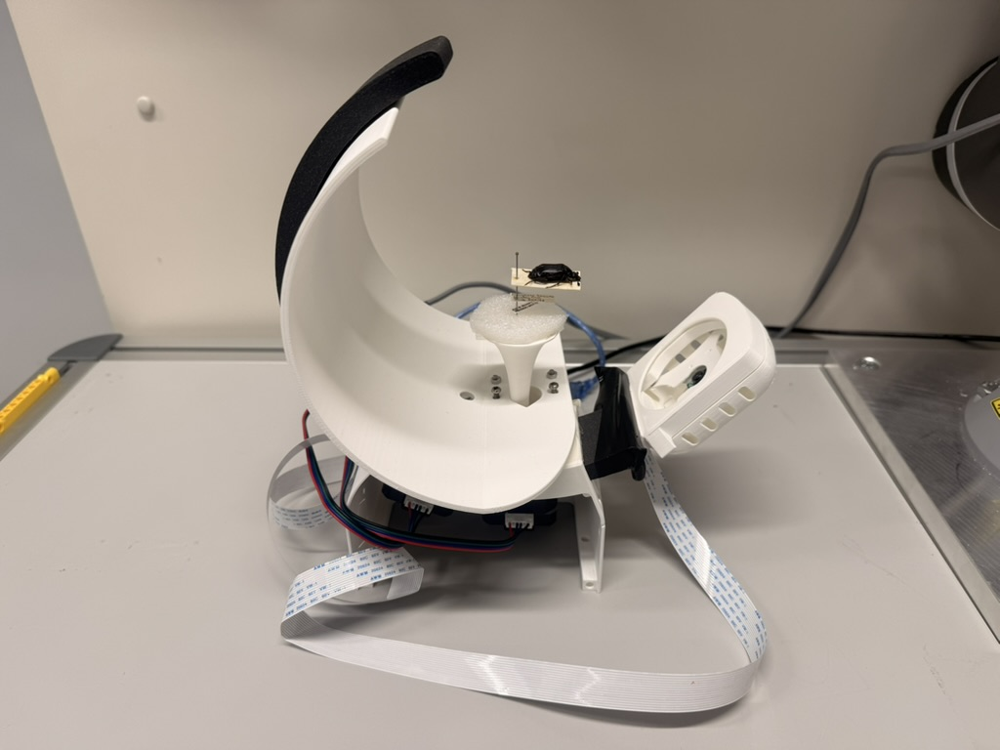
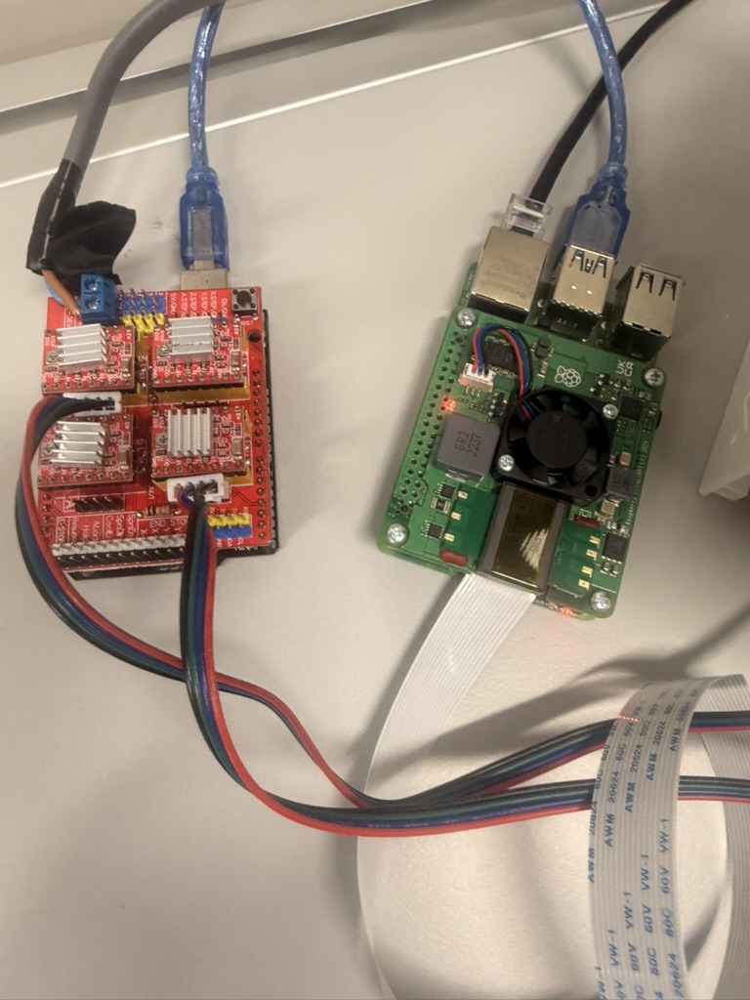
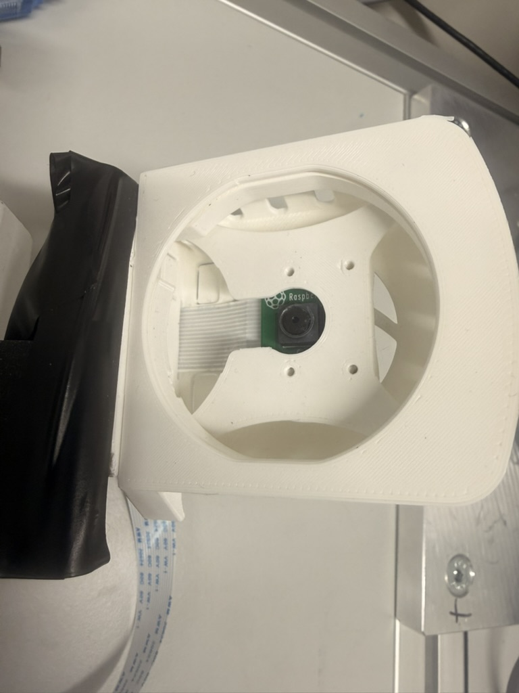

# Setup and notes

[Back to the project](../README.md)

## Analyse your own photographs

Install the project using the commands on the front page. On Windows, activate the environment with `.venv\Scripts\Activate.ps1` instead of `source .venv/bin/activate`.

Start a vision model in your preferred local runtime, using its OpenAI-compatible API. Then supply its actual model identifier and API base URL:

```bash
traittrail-experiment analyse examples/qwen/sources/beetle/image.jpg \
  --base-url http://127.0.0.1:8000/v1 \
  --model YOUR_VISION_MODEL \
  --specimen-id my-beetle \
  --output runs/my-beetle

traittrail-experiment view runs/my-beetle/record.json --output runs/review
```

You can supply several photographs of the same specimen in one command. Use a distinct specimen ID for each specimen. The output directory must be new, so a run cannot overwrite earlier evidence. Model weights and the server are not included.

The default asks for normalised `x, y, width, height` regions. Use `--bbox-format qwen-1000-xyxy` when the endpoint should return Qwen's integer 0–1000 corner coordinates. If the server does not support a JSON schema, choose `--response-format json-object` or `none`. Optional `--reasoning-effort` and `--hardware` values are recorded; hardware descriptions are user declarations.

For an endpoint requiring a key, set `TRAITTRAIL_API_KEY` in your environment. It is sent in the request header and is not saved in the run files.

## Bring runs together

```bash
traittrail-experiment graph runs/specimen-one/record.json runs/specimen-two/record.json \
  --output runs/combined
```

The report includes an image viewer, a feature graph, `observations.csv`, `records.json` and `graph.json`. Repeated models or views do not inflate the number of specimens in a shared-feature group. Different predictions remain visible.

## Files and figure tools

| Folder | Contents |
|---|---|
| `src/` | The runnable experiment |
| `examples/` | Photographs, saved predictions and display panels |
| `scripts/` | Figure tools and data checks |
| `examples/scans/` | Five complete scans and their saved-results viewer |
| `archive/` | Earlier research material and a file-by-file preservation manifest |
| `tests/` | Workflow checks |
| `docs/` | These notes and the adapted-code licence notice |

Generated runs are written to `runs/`, which Git ignores. Rebuild the figures into a separate folder with:

```bash
traittrail-experiment figures --output runs/figures
```

Arial reproduces the approved typography; other systems can use an available font or supply `--font` and `--bold-font` paths. The combined Qwen figure, caption and individual panels are in `examples/qwen/figures/`, including the 600 dpi PNG and TIFF. Other-model figures are in `examples/other-models/figures/`.

Run `traittrail-experiment check` to check saved input hashes and response structure. For development, install `python -m pip install -e '.[dev]'` and run `python -m pytest -q`.

## Open the original scans

The complete scanner dataset contains **200 original photographs, 196 crops and 40 model responses** from five scans. Of those response batches, 35 passed structural validation and five failed; both successful and failed responses are retained. These runs used Codex / GPT-6 Astra and are separate from the later Qwen figure examples.

From the repository folder, on macOS or Linux:

```bash
cd examples/scans
./start-demo.sh
```

Open **http://127.0.0.1:8765/**. The launcher installs its dependencies and opens a saved scan. It does not connect to the scanner or call a model. Select a feature to inspect the supporting photograph and the recorded answer.

Choose another scan with `./start-demo.sh --scan 2`. To list all five scans, use `./start-demo.sh --list`. After the first installation, the viewer can run offline with `.venv/bin/python run_demo.py`.

On Windows, install `examples/scans/requirements.txt` and run `python examples/scans/run_demo.py` from the repository folder. New model runs through the older scanner interface require Linux, macOS or WSL; the saved-results viewer does not.

The original files are checked and copied into a separate `examples/scans/runs/SCAN_ID/` working folder before opening. Reviews do not overwrite the retained source data. The old acquisition system reused `pilot:001` for different physical specimens, so each saved scan opens separately.

`python scripts/summarise_scans.py` writes a count/timing summary to `runs/scan-summary.csv`. `python scripts/check_capture.py` checks the retained files imported from the frozen Capture snapshot. The source files occupy about 770 MB, mostly photographs and historical material.

`python scripts/check_release.py` checks the shared files and ZIP contents for common credentials, personal computer paths, private-network identifiers and photograph GPS coordinates.

## Experiment and current workflow

Can an off-the-shelf vision-language model (VLM) use its learned knowledge to identify visible features in specimen photographs, given a prompt and software to collect its answers, without fine-tuning?

The workflow asks about 16 features: visible wings, antennae, legs, eyes, colour, pattern, hairs, condition, mounting hardware and image detail. Each observed answer needs a region in a supplied photograph. Hidden anatomy should remain unknown. Counts need separate instance IDs; images from several views should not turn one part into several parts. The vocabulary was developed for pinned insects. The shell is a later example outside that original scope, rather than evidence that every insect feature applies to shells.

`src/traittrail_experiment/prompt.txt` is the current prompt for new runs. The final prompt includes the image catalogue, vocabulary and response schema. Every new run keeps its exact prompt, input bytes/checksums, request, response and validation result. Coordinate conversion is explicit: normalised `x,y,width,height` or Qwen's integer `x1,y1,x2,y2` on a 0–1000 scale. Boxes are not silently repaired.

The `traittrail-experiment` command uses a vision endpoint's chat-completions API and starts with saved photographs. A model server must already be running for new inference. Offline viewers and tests need no model; endpoint tests use a synthetic local HTTP service and do not establish live model accuracy or performance.

## Retained evidence

`examples/catalog.json` links **12 runs, five specimens and 14 unique input photographs**, with exact source checksums and explicit specimen identities. A repeated `pilot:001` in old records does not mean that different scans contain the same specimen.

| Material | Retained records |
|---|---|
| Qwen: long-antenna beetle | `examples/qwen/sources/beetle/`; `run_517a20489a604ff5`, 14 October 2026 |
| Qwen: spread-wing Aglais io LM00125 | `examples/qwen/sources/spread-butterfly/`; `run_952340fb59304734` |
| Qwen: closed-wing Naturalis specimen | `examples/qwen/sources/folded-butterfly/`; `run_5538dd38417b4dc0` |
| Codex: striped beetle and shell | `examples/other-models/sources/codex-damage/` and `codex-shell/`; all five input views for each run, exact prompts and raw replies |
| Later API examples | `examples/other-models/sources/beetle/` and `butterfly/`; GPT-6 Astra, Claude, Gemini and Kimi results and original input images |

The specimen photographs and model predictions are retained. Identifying computer paths and scanner network/device details are replaced with generic examples in the shared records. The catalogue resolves input IDs to the files here, and checksums describe the distributed copies. Figure manifests retain selected observations, crops, rotation and hashes. The twelve-panel figure uses the same crop/orientation within each row. The beetle is rotated 90 degrees anticlockwise. Photographs are shown at different magnifications. Display labels do not correct model boxes or anatomical names.

The viewer and graph are derived from these originals. Graph nodes link specimens, images, model runs, observations and features. Shared-value groups count distinct specimens, rather than views or repeated runs. Conflicting answers remain attached to their own run and image. Model agreement is not anatomical verification.

## Scientific limits and missing records

- The three Qwen example exports record `qwen3.8:27b-mtp-q8_0`, using Qwen3.8-27B. Processed observations and prompt/raw-reply hashes are retained; the exact prompt text and underlying raw replies are not included in these exports.
- The original presentation named a 32B Qwen vision model. The extracted talk examples are retained in `examples/presentation/` with their original annotations; the current twelve-panel figure uses the additional 27B runs.
- Exact hardware/runtime/build records for the later Qwen runs remain incomplete. A filename mentioning GB10 does not establish inference hardware. A new run's `--hardware` value is a user declaration, not automatic verification.
- Prompts, effort settings and retries differ. The wide-view Qwen record reports reasoning effort `none`; other examples use different settings. These are qualitative demonstrations, not a controlled test of reasoning, an accuracy ranking or calibrated confidence.
- Model predictions remain unreviewed. The beetle colour answer misses pale markings, and some regions are broad or misplaced. Codex's condition example leaves damage unknown, rather than confirming a break. Schema checks establish response structure and some consistency rules, not biological correctness.

The new workflow keeps complete records for future experiments. The retained historical exports contain the gaps described above, so they cannot all be reproduced from their original prompts and raw replies.

## Imaging, hardware and references

### The original setup

The original rig was a modified [OpenScan Mini](https://openscan.eu/pages/openscan-mini), using a Raspberry Pi 4, Pi Camera V2 and Arduino Uno stepper control. Eight positions and five camera bands produced 40 photographs per scan, saved before analysis. Commanded steps should not be treated as independently verified camera angles.

| Modified OpenScan Mini | Raspberry Pi and stepper controller |
|---|---|
|  |  |

| Camera and light | Dell GB10 systems |
|---|---|
|  |  |

Photographs: Jack Dan Hollister, [CC BY 4.0](https://creativecommons.org/licenses/by/4.0/), from `LT17_01_Hollister.pptx`: the rig appears on slides 8–9, and the controller, camera and Dell systems on slide 10. GPS and device metadata have been removed; visible pixels and orientation are unchanged. File checksums and source image names are recorded in [images/sources.json](images/sources.json).

The original scan records are included in this repository; the current image-analysis command and the saved-results viewer work without connecting the rig.

Dell made GB10 systems available for the local work. GB10 uses NVIDIA's Grace Blackwell platform; the cited Dell specification has 128 GB of shared memory. These references describe hardware and model families, rather than measured throughput or accuracy in this study:

- Dell Technologies (n.d.) [Dell Pro Max with GB10](https://www.delltechnologies.com/asset/en-gb/products/workstations/technical-support/dell-pro-max-with-gb10-workstation-brochure-and-spec-sheet.pdf.external). Product brochure and specification sheet. Accessed 30 October 2026.
- NVIDIA. [GB10 / DGX Spark hardware information](https://www.nvidia.com/en-us/products/workstations/dgx-spark/) and [user guide](https://docs.nvidia.com/dgx/dgx-spark/). The work used Dell systems; these describe the platform.
- Skende A, Rosseel G, Pinckney N (2026) 17.1 NVIDIA GB10: SoC Built for AI Acceleration. In: 2026 IEEE International Solid-State Circuits Conference (ISSCC). IEEE, 298–300. [https://doi.org/10.1109/ISSCC49663.2026.11409351](https://doi.org/10.1109/ISSCC49663.2026.11409351)
- Qwen Team (2026) [Qwen3.8-27B](https://huggingface.co/Qwen/Qwen3.8-27B). Model card. Hugging Face. Accessed 30 October 2026.
- OpenScan (n.d.) [OpenScan Mini](https://openscan.eu/pages/openscan-mini). Official product and hardware information. Accessed 30 October 2026.

## Original sources

The saved scans and earlier research records from Capture commit `4bd63c7003c547aba9bee743529b8e6b76d55c44` are collected here. Workstation paths and scanner network/device identifiers are redacted in the publication copy. The original repository is not needed to run or inspect this project.

<details>
<summary>Earlier code and research records</summary>

- The five scan bundles and portable viewer are in `examples/scans/`.
- [capture-history.zip](../archive/capture-history.zip) contains the older graph experiment, hackathon material, development notes and original copies of relocated documentation. The graph's map localities are simulated examples, not specimen collection locations. This is historical material rather than a second installation step.
- [capture-manifest.json](../archive/capture-manifest.json) maps the 10,412 retained source files to their locations and checksums. It also lists the 40 operating-scanner source files omitted from this repository and records original hashes where identifying metadata was changed. The scan photographs, feature predictions and region coordinates are unchanged. `python scripts/check_capture.py` verifies the retained copies without contacting another repository.
- The vocabulary and validator are adapted from TraitTrail Studio at commit `2fbfdbaf8aacc726f0f90da45e0f106371ccf28a`. Its original MIT notice is retained in [licenses/traittrail-studio-MIT.txt](licenses/traittrail-studio-MIT.txt).
- [OpenScan Mini](https://openscan.eu/pages/openscan-mini) supplied the rig's starting design.

</details>

## Credits and reuse

| Photographs | Credit and terms |
|---|---|
| Scanner photographs, their crops, beetle and shell examples, setup photographs and extracted specimen images from the talk | Jack Dan Hollister, [CC BY 4.0](https://creativecommons.org/licenses/by/4.0/). Credit the photographer, link the licence and identify any changes. |
| Spread-wing Aglais io LM00125 | Lauri Mällo / PlutoF; [GBIF 2234225450](https://www.gbif.org/occurrence/2234225450), [CC BY 4.0](https://creativecommons.org/licenses/by/4.0/). Overlays and cropped/resized displays are derived figures. |
| Closed-wing Naturalis ZMA.INS.1533437 | Naturalis Biodiversity Center; [original image](https://medialib.naturalis.nl/file/id/ZMA.INS.1533437_2/format/large), CC0 in the retained provenance. Overlays and cropped/resized displays are derived figures. |
| NHM butterfly thumbnails in the historical graph archive | The Trustees of the Natural History Museum, London; CC BY 4.0. Original specimen identifiers and image hashes are retained in the archived index and the [media records](licenses/media.json). The Museum's [image-attribution guidance](https://data.nhm.ac.uk/about/citation) describes reuse of collection photographs. |
| Synthetic images in the historical graph demo | Illustrations generated by the included demo code; these are not specimen photographs or biological observations. |

The [media records](licenses/media.json) describe the current photograph licences. `examples/other-models/sources/original-image-notices.txt` is the unchanged historical notice from Studio; the current CC BY 4.0 grant for Jack Dan Hollister's photographs is recorded separately so the original source notice stays intact. A model name identifies a prediction's source, rather than the photographer or a human author.

The software uses the [MIT licence](../LICENSE), including the saved-scan viewer and adapted Studio vocabulary/validator. Photographs, figures and archived research records retain their individual credits and permissions; MIT does not assign an image/data licence. GBIF responses in the historical graph archive retain their recorded dataset licences and source information. Model weights and API credentials are not distributed. [CITATION.cff](../CITATION.cff) contains the software citation metadata for GitHub and Zenodo.

The historical graph's country outlines are from [Natural Earth](https://www.naturalearthdata.com/about/terms-of-use/), which makes its map data available in the public domain.
