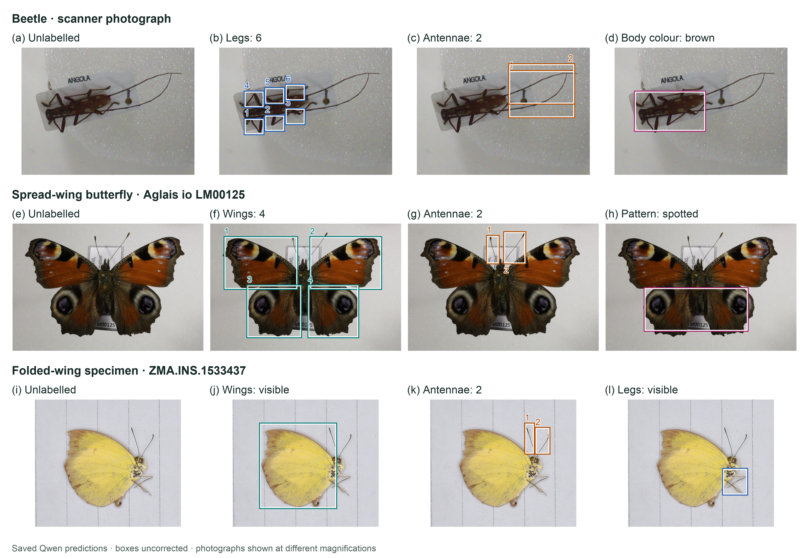

# Agentic AI Systems for Specimen Interaction and Camera-Based Observation

Jack D. Hollister*1 and Steen Dupont1

1. Natural History Museum, London, United Kingdom

Computer vision is increasingly used to extract biological information from specimen images. Classical image-based artificial intelligence (AI) methods used task-specific convolutional neural networks (CNNs) to distinguish similar taxa, identify informative morphological regions, detect cryptic divergence and flag potentially mislabelled collection specimens (Hollister et al. 2023, 2025, 2026). Biological foundation models such as BioCLIP offer more generalisable representations (Stevens et al. 2024), while multimodal language models can describe visible biological features and answer questions about image content in natural language (Miao et al. 2026).

We tested whether a general-purpose vision-language model (VLM) could observe specimens, extract prompted morphological features and link structured observations in a graph. We used Qwen3.8-27B, an open-weight VLM, without task-specific fine-tuning (Qwen Team 2026), running locally on a Dell Pro Max with GB10 based on NVIDIA Grace Blackwell architecture (Dell Technologies n.d., Skende et al. 2026). A modified [OpenScan Mini](https://openscan.eu/pages/openscan-mini) (OpenScan n.d.) combined a Raspberry Pi 4, Pi Camera V2 and Arduino-based stepper control. The specimen could rotate through 360 degrees while the camera could move through approximately 150 degrees to capture multiple viewpoints. A software harness coordinated specimen selection, imaging, prompts, responses and structured records. Prompts used predefined rules and questions about visible traits: wing and leg presence and number, colour and physical damage.

Specimens were sampled from the available set, imaged and passed to the local VLM. Responses were converted into JavaScript Object Notation (JSON) tags and linked to specimens in a graph network. The graph could be queried across specimens, traits and taxa to explore shared features and patterns. Demonstration outputs included multiple visible features and condition information such as damage (Fig. 1). This was a technical proof of concept; we did not measure identification or feature-detection accuracy. The same general model performed several prompted observation tasks without training a separate classifier for each taxonomic or morphological problem.

These observations suggest that VLMs can identify candidate morphological features from their existing knowledge, although our prompts covered only a small set of traits. Expert comparisons are needed to test repeatability, viewpoint effects and finer anatomical detail. Future work could combine identification keys and targeted image-analysis methods to guide models towards more detailed features. We developed the workflow into TraitTrail for reviewing image-linked observations and exploring shared features across specimens.

Code and saved examples: https://github.com/JackDanHollister/local-vlm-morphology.

Keywords: morphology, multimodal inference, knowledge graphs, natural history museums, foundation models

## References

Dell Technologies (n.d.) Dell Pro Max with GB10. Product brochure and specification sheet. Available from: https://www.delltechnologies.com/asset/en-gb/products/workstations/technical-support/dell-pro-max-with-gb10-workstation-brochure-and-spec-sheet.pdf.external (October 30, 2026).

Hollister JD, Cai X, Horton T, Price BW, Zarzyczny KM, Fenberg PB (2023) Using computer vision to identify limpets from their shells: a case study using four species from the Baja California peninsula. Frontiers in Marine Science 10: 1167818. https://doi.org/10.3389/fmars.2023.1167818

Hollister JD, Martin G, Cai X, Horton T, Powell O, Sterling M, Turnbull G, Price BW, Fenberg PB (2025) A Computer Vision Method for Finding Mislabelled Specimens Within Natural History Collections. Ecology and Evolution 15: e71648. https://doi.org/10.1002/ece3.71648

Hollister JD, Paz-García DA, Beas-Luna R, Horton T, Cai X, Fenberg PB (2026) Genes, shells, and AI: using computer vision to detect cryptic morphological divergence between genetically distinct populations of limpets. Scientific Reports 16: 1051. https://doi.org/10.1038/s41598-025-30613-1

Miao Z, Zhang Y, Fabian Z, Hernandez Celis A, Beery S, Li C, Liu Z, Gupta A, Nasir M, Li W, Holmberg J, Palmer M, Gaynor K, Arbelaez P, Wang P, Dodhia R, Ferres JL (2026) New frontiers in artificial intelligence for biodiversity research and conservation with multimodal language models. Methods in Ecology and Evolution 17: 238–256. https://doi.org/10.1111/2041-210X.70120

OpenScan (n.d.) OpenScan Mini. Available from: https://openscan.eu/pages/openscan-mini (October 30, 2026).

Qwen Team (2026) Qwen3.8-27B. Model card. Hugging Face. Available from: https://huggingface.co/Qwen/Qwen3.8-27B (October 30, 2026).

Skende A, Rosseel G, Pinckney N (2026) 17.1 NVIDIA GB10: SoC Built for AI Acceleration. In: 2026 IEEE International Solid-State Circuits Conference (ISSCC). IEEE, 298–300. https://doi.org/10.1109/ISSCC49663.2026.11409351

Stevens S, Wu J, Thompson MJ, Campolongo EG, Song CH, Carlyn DE, Dong L, Dahdul WM, Stewart C, Berger-Wolf T, Chao W-L, Su Y (2024) BioCLIP: A Vision Foundation Model for the Tree of Life. In: 2024 IEEE/CVF Conference on Computer Vision and Pattern Recognition (CVPR). IEEE, 19412–19424. https://doi.org/10.1109/CVPR52733.2024.01836

Acknowledgements: We thank Dell Technologies and NVIDIA for providing access to and support for the local AI computing infrastructure used in this work.

## Figure 1

Figure 1. Additional Qwen examples: beetle (a–d), spread-wing butterfly (e–h) and closed-wing butterfly (i–l). Each row shows an unlabelled image and three feature views; boxes and numbers mark predicted regions. Images are cropped; the beetle is rotated 90° anticlockwise. Model: qwen3.8:27b-mtp-q8_0. Photos: Jack Dan Hollister, CC BY 4.0 (a–d); Lauri Mällo/PlutoF, CC BY 4.0 (e–h); Naturalis Biodiversity Center, CC0 (i–l).
